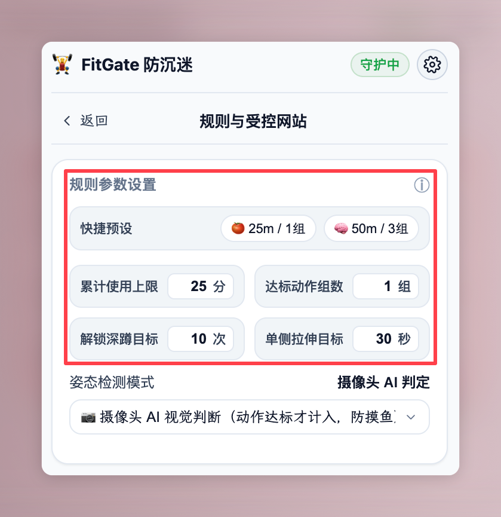
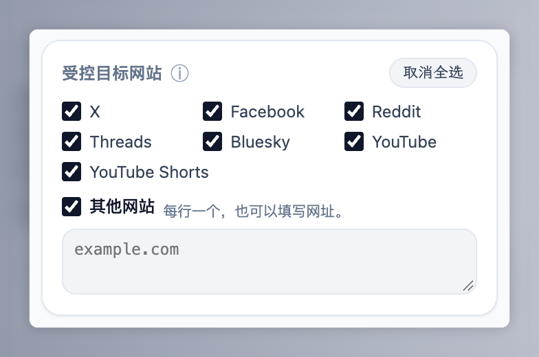
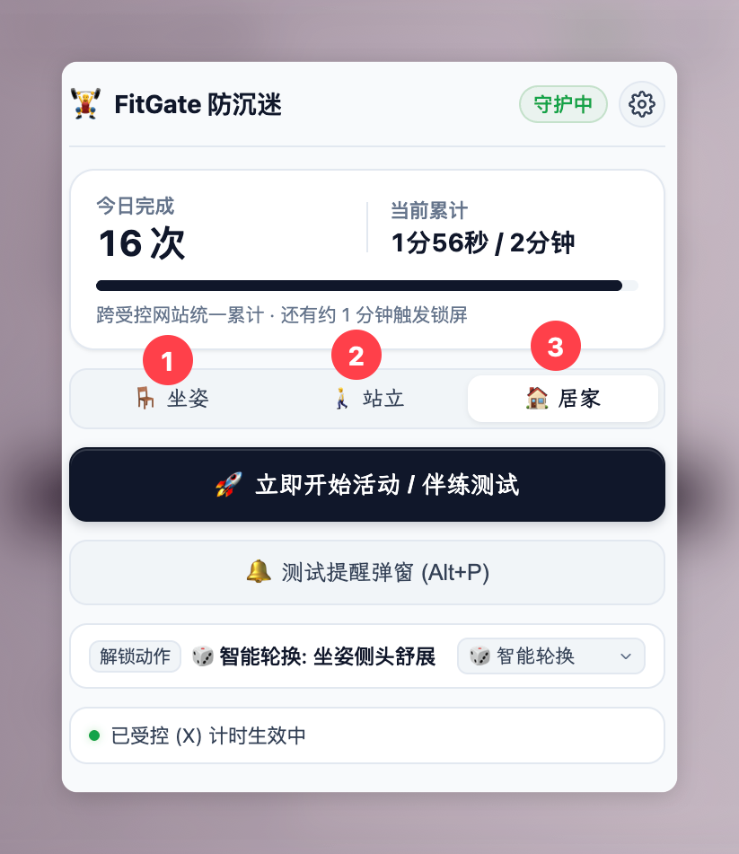
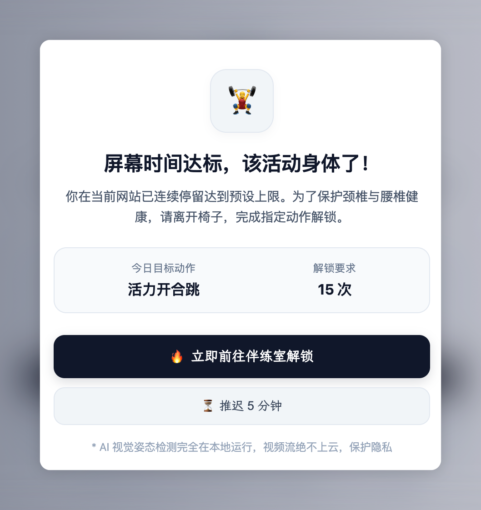
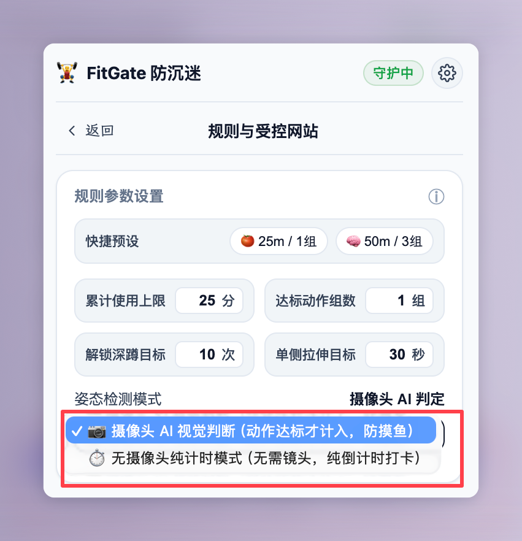
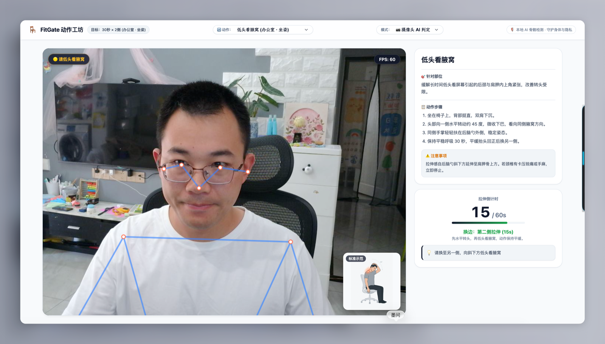
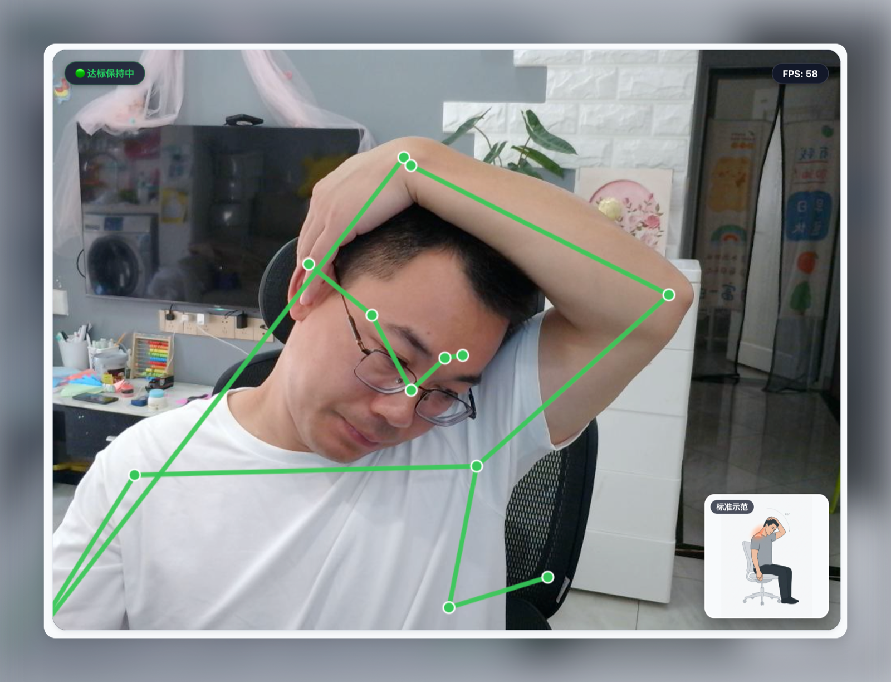
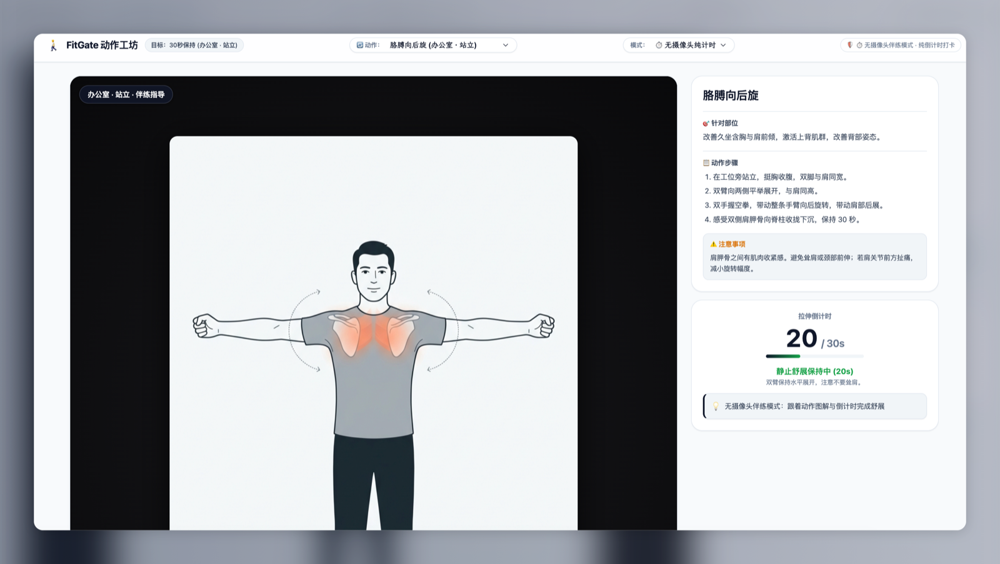

# FitGate

FitGate 是一个基于 Chrome Manifest V3 的网页使用时间控制与身体活动伴练扩展。当受控网站的累计使用时间达到设定阈值时，扩展会在网页上方覆盖全屏提示层，要求使用者完成指定场景下的身体活动动作后解除锁定。

现已提供独立的 **macOS 桌面版**，可统计整台电脑、指定应用或指定网站的使用时间，并通过全屏休息提醒与动作伴练帮助定时活动。支持 Intel 和 Apple Silicon，要求 macOS 13 或以上。

[下载 macOS 安装包](https://github.com/longhaiqwe/fitgate/releases) · [桌面版使用与构建说明](fitgate-macos/README.md) · [兼容性验证](fitgate-macos/COMPATIBILITY.md)

---

## 一、安装与加载

### 1. 构建扩展
克隆本仓库到本地，并在项目根目录下执行依赖安装与打包命令：

```bash
git clone https://github.com/longhaiqwe/fitgate.git
cd fitgate
npm install
npm run build
```

命令执行完成后，项目根目录会生成 `dist/` 文件夹。

### 2. 加载到 Chrome 浏览器
1. 打开 Chrome 浏览器，在地址栏输入 `chrome://extensions/` 并回车；
2. 开启右上角的“开发者模式”；
3. 点击左上角的“加载已解压的扩展程序”；
4. 选择本项目根目录下的 `dist` 文件夹完成加载。

---

## 二、使用流程

### 1. 配置规则参数与受控网站

点击浏览器工具栏中的 FitGate 图标打开面板，点击“规则设置”进入配置页。

#### (1) 规则参数设置
使用者可以根据自身节奏设置以下四项参数：
- **累计使用上限**：在受控网站停留的累计时间（分钟），达到该数值后触发页面锁定；
- **达标动作组数**：每次解锁需要完成的动作组数（1~5 组）；
- **解锁深蹲目标**：深蹲模式下的单组要求次数（次）；
- **单侧拉伸目标**：拉伸动作单侧或单次保持的目标时长（秒）。



#### (2) 受控目标网站设置
在目标网站列表中勾选需要纳入时间统计的站点（如 X、Bilibili、YouTube、微博等）。若需要控制其他网站，勾选“其他网站”并在文本框中按行填入域名（如 `example.com`）。



---

### 2. 选择当前所处场景

返回主界面，根据当前工作环境选择对应的场景分类：

- **坐姿（办公室 · 不可站起）**：5 个动作，完全坐在办公椅上完成，幅度局限于头部与颈部轻缓侧屈与后展；
- **站立（办公室 · 可站起来）**：包含坐姿动作及 5 个站姿动作，在工位旁站立开展胸背与腰椎拉伸；
- **居家（居家办公 · 大动作）**：包含工位动作及标准深蹲、开合跳等全身性动作。

在“解锁动作”下拉栏中，默认设置为“智能轮换”，系统将在当前场景的动作库中依次调度动作；也可以手动指定某一个固定动作。



---

### 3. 日常浏览与超时锁定

配置完成后，正常使用浏览器。当使用者处于受控网站且当前标签页可见并拥有焦点时，插件后台会按秒累加使用时间。

当累计时间达到设定的使用上限时，当前页面会弹出全屏提示层，页面的点击与滚动操作被阻断。

提示层包含两个操作选项：
- **进入伴练**：打开独立伴练标签页，开始进行动作；
- **稍后提醒（推迟 5 分钟）**：临时关闭提示层，将锁定状态后延 5 分钟。



---

### 4. 进入伴练页面完成动作

点击“进入伴练”后，浏览器会新建并切换到独立伴练标签页。

界面左侧显示当前动作的名称、分步说明、正确姿态要点与安全停止准则；右侧为动作交互区域，提供两种运行模式：



#### 模式 A：摄像头 AI 检测模式（默认）
使用本地 TensorFlow.js MoveNet 模型实时推算人体 17 个关键骨骼点。所有画面运算均在浏览器本地内存中完成，图像数据不离开本机设备。

- **动作未到位**：骨骼连线显示为蓝色，界面提示调整角度或位置，此时计时器暂停或不计入深蹲次数；
- **动作到位**：骨骼连线转为绿色，系统开始扣减倒计时或在深蹲完成一个标准周期后计数递增。

| 动作未到位（蓝色） | 动作到位（绿色） |
| :---: | :---: |
|  |  |

#### 模式 B：无摄像头纯计时模式
若设备未配备摄像头，或当前环境不便调用摄像头，可在伴练页右上角将检测模式切换为“无摄像头纯计时模式”。该模式下系统提供节奏音效与倒计时推进，由使用者自主对照左侧图文完成动作。



---

### 5. 达成目标与自动解锁

当完成当前动作的设定时长或次数后：
1. 若设定的动作组数大于 1 组，系统会自动进入下一组动作；
2. 当所有组数均达标后，系统播放提示音，弹出通关提示；
3. 后台向所有被锁定的受控网页广播解锁指令，清除遮罩；
4. 伴练标签页在 2 秒后自动关闭，焦点回到原网页。

---

## 三、动作分类列表

系统收录的 12 个分级动作定义如下：

| 场景 | 动作名称 | 动作形式 | 作用部位 |
| :--- | :--- | :--- | :--- |
| **办公室 · 坐姿** | 背后交扣侧头 | 双侧轮换，各 30 秒 | 颈肩交界处（上斜方肌） |
| **办公室 · 坐姿** | 耳朵找肩膀 | 双侧轮换，各 30 秒 | 颈侧（斜角肌） |
| **办公室 · 坐姿** | 低头看腋窝 | 双侧轮换，各 30 秒 | 颈后侧与肩胛骨上方（肩胛提肌） |
| **办公室 · 坐姿** | 手按锁骨看斜上方 | 双侧轮换，各 30 秒 | 前颈对角线（胸锁乳突肌） |
| **办公室 · 坐姿** | 托后脑低头 | 单次保持 30 秒 | 后脑勺下方（枕下肌群） |
| **办公室 · 站立** | 举手翻掌 | 单次保持 30 秒 | 胸廓与肩关节前侧 |
| **办公室 · 站立** | 胳膊向后旋 | 单次保持 30 秒 | 上背部（菱形肌、肩胛骨内收） |
| **办公室 · 站立** | 扶腰后伸 | 循环 8 次（每次 5 秒） | 腰椎后伸与骨盆支撑 |
| **办公室 · 站立** | 站姿小燕飞 | 循环 8 次（每次 4 秒） | 背部后侧肌群激活 |
| **办公室 · 站立** | 交叉腿叉腰侧屈 | 双侧轮换，各 25 秒 | 侧腰深层（腰方肌） |
| **居家办公** | 标准深蹲 | AI 视觉计数，默认 10 次 | 臀部与大腿下肢大肌群 |
| **居家办公** | 活力开合跳 | AI 视觉计数，默认 15 次 | 全身动作与心率调节 |

---

## 四、安全使用边界

1. **温和幅度**：动作以产生轻微牵拉感为限，不应追求大幅度受力。
2. **轻缓引导**：头部动作中，双手仅用于提供触觉定位与自重引导，不得外力按压头部或扭转颈椎。
3. **即刻停止**：若在动作过程中出现尖锐疼痛、四肢发麻、眩晕或恶心，表明局部神经或血管受到挤压，须立刻停止该动作。
4. **病理性限制**：存在急性颈椎间盘突出、急性腰扭伤或脊柱滑脱病史的人群，应遵从临床医嘱，不建议自行尝试大幅度牵拉动作。

---

## 五、项目工程与测试

### 1. 技术栈
- **扩展规范**：Chrome Extensions Manifest V3
- **构建工具**：Vite 5
- **视觉模型**：TensorFlow.js + MoveNet Lightning（本地 WebGL 加速）
- **隔离机制**：Shadow DOM（闭合模式隔离目标页 CSS）
- **音频系统**：Web Audio API（纯代码合成正弦波音效，无外部音频文件）

### 2. 运行测试
项目包含 11 个单元测试套件，覆盖几何夹角计算、状态机流转、丢帧容错、平滑滤波与时间解析等逻辑：

```bash
npm test
```

### 3. 本地开发预览
```bash
npm run dev
```
