# 工位与居家办公身体放松的 15 个动作底层规律与操作清单

这份整理归纳自插件动作库、本地工位动作指南底稿，以及小红书 12 篇无器械跟练视频与图文笔记（涵盖中国中医科学院西苑医院康复指导、物理治疗师科普、健身博主分享，并结合本地 MoveNet AI 骨骼姿态检测模型）。逐篇素材核读记录与出处索引见文末。

这里的“动作清单”针对健康人群久坐后的肌肉僵硬与体态疲劳；描述全部采用**客观白描**，已剔除原文中所有“巨爽、宇宙级、神级、狠狠、绝绝子、救星”等情绪化和营销类修饰词。**未给出的动作参数不主观臆造；涉及解剖学机制但缺少临床试验支持的，均标为“博主说法待核实”。**

> **安全与停止指征声明（非医疗建议）：**
> 本清单动作仅作为日常久坐身体活动参考，不构成任何医疗诊断或康复处方。若患有颈椎病、腰椎间盘突出症急性期、脊柱滑脱、严重骨质疏松或关节损伤史，请遵医嘱。
> **安全红线：** 动作过程中以温和拉伸感或轻度肌肉酸胀为限。一旦出现**尖锐刺痛、肢体麻木放电感、头晕眩晕或恶心**，说明可能压迫神经或血管，必须**立即停止**。

---

## 动作总览

动作库按办公与居家场景分为 3 类，共 **15 个动作**：
- **办公室 · 坐姿（不可站起，6 个）：** 动作完全在办公椅上完成，幅度隐蔽，不打扰周围同事。
- **办公室 · 站立（可站起，6 个）：** 在工位旁或墙边站立完成，舒展胸背、腰椎与肩颈。
- **居家办公 · 大动作（3 个）：** 动作幅度大或需垫上完成，含 AI 骨骼视觉识别深蹲与地面减压伸展。

---

## 第一部分：办公室 · 坐姿（不可站起，6 个）

### 1. 背后交扣侧头：通过对侧手臂下拉，固定肩胛骨以拉伸颈侧

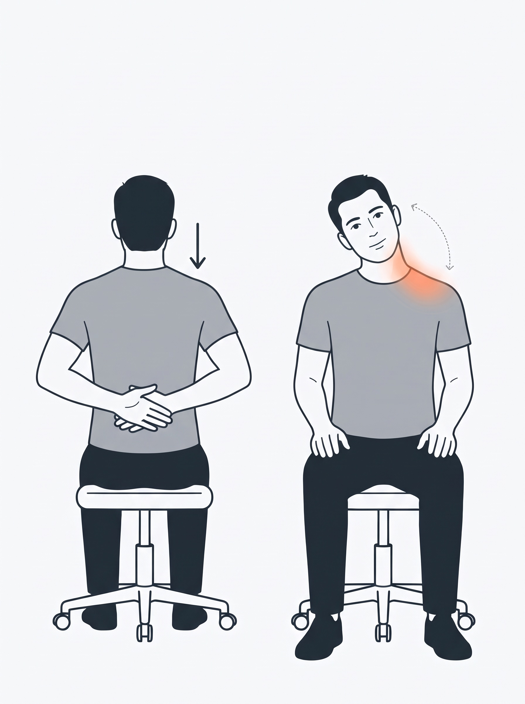

- **管什么：** 上斜方肌上束、颈侧肌群。久坐打字时双肩不自觉耸起、肩颈交界处紧绷。
- **怎么做：** 
  1. 坐在办公椅上，背部挺直，双肩自然下沉。
  2. 双手移至背后，十指相扣，手肘向内微夹。
  3. 将交扣的双手移至一侧腰间，手肘主动往身体中线靠拢。
  4. 呼气时，头缓慢倒向双手放置的同侧（拉伸对侧颈部），保持 35 秒（约 4~5 次均匀深呼吸）。
  5. 缓慢抬头回正，换另一侧重复。
- **做对了 / 停止指征：**
  - *做对了：* 倒向侧对边的颈肩交界处有平缓展开的牵拉感，肩部没有向上耸起。
  - *停止指征：* 若手臂或手指出现麻木、发冷、针刺放电感，说明牵拉影响到臂丛神经分支，立即松开双手并停止。
- **出处与说明：** 出自工位底稿及物理治疗师-Marco《最伟大拉伸（颈部版）》【10，图 02】。通过将手固定在腰侧，利用手臂自重将对侧肩胛骨被动下拉，避免侧头时肩膀跟着抬起的代偿。

---

### 2. 耳朵找肩膀：利用自重与手掌轻搭，单向牵拉斜角肌

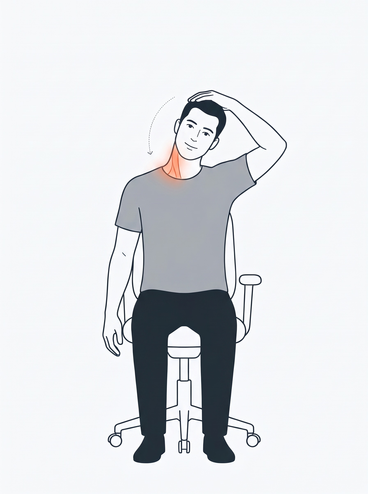

- **管什么：** 颈侧斜角肌。多屏办公频繁偏头、单侧颈部肌张力偏高。
- **怎么做：**
  1. 端坐办公椅，双肩自然下沉，目视前方。
  2. 头部平缓向一侧倾斜，使一侧耳朵靠近同侧肩膀。
  3. 同侧手臂抬起，手掌轻搭在头顶对侧；**手掌仅作重力搭放，严禁用手臂力量向下强行按压。**
  4. 另一侧手臂垂直自然下垂，静态保持 30 秒。
  5. 缓慢回正头部，换另一侧重复。
- **做对了 / 停止指征：**
  - *做对了：* 颈侧肌肉有轻微紧绷张力，未出现耸肩代偿。
  - *停止指征：* 若搭手的手臂用力下扳、颈椎侧面出现压迫刺痛，或手指出现麻木感，立即移开手掌并回正头部。
- **出处与说明：** 出自工位底稿第 4 动作及颈脖然跟练视频【04，00:03—00:12】。原视频强调“手不要用力按”，只借手臂重量作为辅助诱导。

---

### 3. 低头看腋窝：转头配合低头，针对性拉伸肩胛提肌

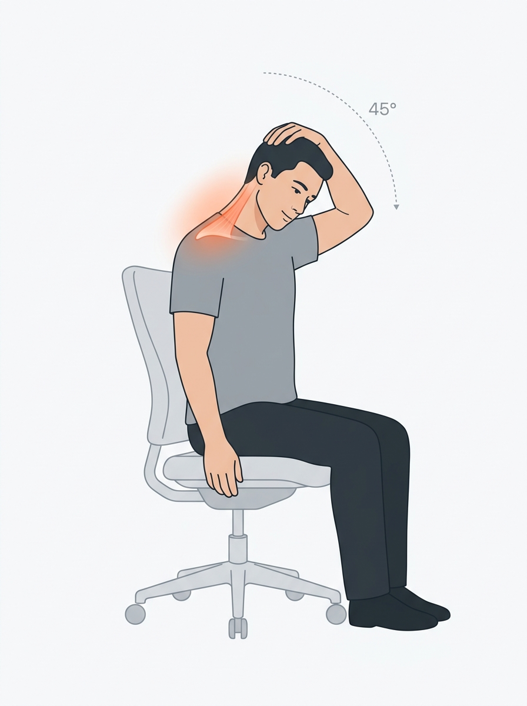

- **管什么：** 肩胛提肌（起自上颈椎横突，止于肩胛骨内上角）。低头看电脑久后转头僵硬、下巴难以贴近胸骨。
- **怎么做：**
  1. 坐在椅子上，背部挺直，双肩保持下沉。
  2. 头部向一侧水平转动约 45 度，随后低头，目光看向同侧腋窝方向。
  3. 同侧手轻扶在后脑勺外侧，起稳定姿态作用，不用力下压。
  4. 保持平稳呼吸，静态维持 30 秒。
  5. 缓慢抬头回正，换对侧重复。
- **做对了 / 停止指征：**
  - *做对了：* 后脑勺斜后方延伸至肩胛骨内上角区域有清晰的拉伸带。
  - *停止指征：* 颈椎后外侧有关节卡压锐痛或后枕部出现搏动性头痛，立即停止。
- **出处与说明：** 出自工位底稿第 5 动作及颈脖然【04，00:12—00:22】。肩胛提肌负责上提肩胛骨并协助颈部侧屈旋转，转头加低头是其标准的解剖走向牵拉位。

---

### 4. 手按锁骨看斜上方：固定皮下筋膜，反向延展胸锁乳突肌

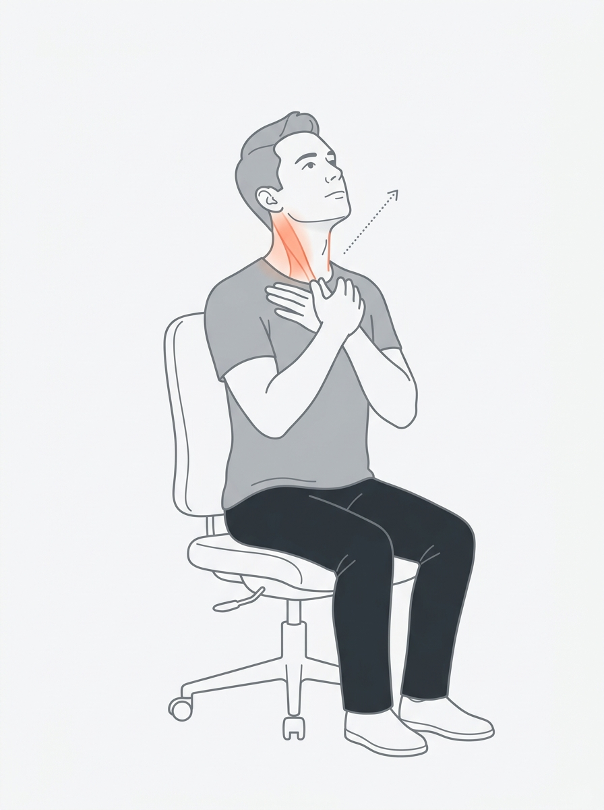

- **管什么：** 胸锁乳突肌前缘、颈阔肌及颈前筋膜。久坐前倾导致的下巴过度前探、颈前组织短缩。
- **怎么做：**
  1. 坐高坐正，双肩自然下沉。
  2. 双手手掌交叉或重叠，按压在胸骨柄与锁骨交界处，手掌轻微向下牵引固定皮肤软组织。
  3. 头部向一侧旋转，目光望向对侧天花板斜上方。
  4. 保持 30 秒，感受颈前对角线方向的延展，缓慢回正后换边。
- **做对了 / 停止指征：**
  - *做对了：* 从锁骨上方延伸至耳后乳突的颈前侧有平缓张力，后颈无压迫感。
  - *停止指征：* 仰头转头过程中若出现后颈挤压刺痛、头晕、眼花或恶心感，立即停止回正；切忌后折脖子。
- **出处与说明：** 出自工位底稿第 6 动作及大程子要努力【01，02:40—03:10】。双手在锁骨处施加的轻度向下固定力，是形成拉伸杠杆的关键基底点。

---

### 5. 托后脑低头：微收下颌下的枕下肌群微幅度减压

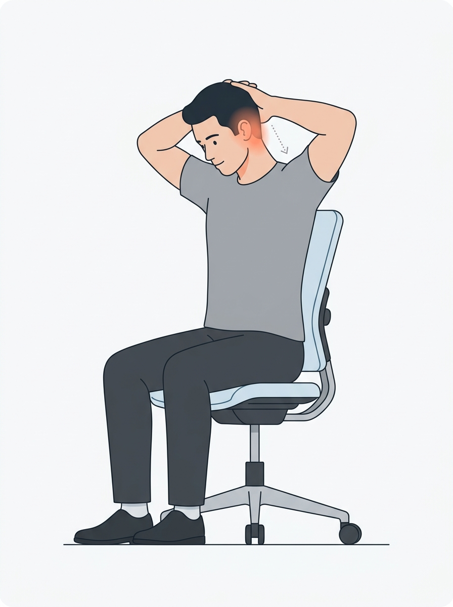

- **管什么：** 枕下肌群（枕骨下缘小肌群）。盯着屏幕久后，后脑勺发紧、眼眶发酸的体态疲劳。
- **怎么做：**
  1. 在椅子上坐直，腰背保持挺拔，不要弯腰含胸。
  2. 双手十指交叉，托在后脑勺枕骨粗隆下方。
  3. 先微收下巴（做出轻微双下巴动作），随后顺应自然重力让头部低垂。
  4. 维持背部挺直，保持均匀深呼吸，静态拉伸 30 秒。
- **做对了 / 停止指征：**
  - *做对了：* 枕骨下方与上颈椎交界处有轻微被拉开的酸胀感，背部未弯曲。
  - *停止指征：* **严禁双手发力向下扳扯脑袋**；若后脑勺出现针刺感或手臂发麻，立即松手。
- **出处与说明：** 出自工位底稿第 7 动作及冰冰i健身【03，00:15—00:28】。央视跟练演示强调动作核心是“收下巴屈上颈椎”，而非弯腰弓背。

---

### 6. 桌下勾脚踮脚：利用小腿肌泵，促进下肢静脉血液回流

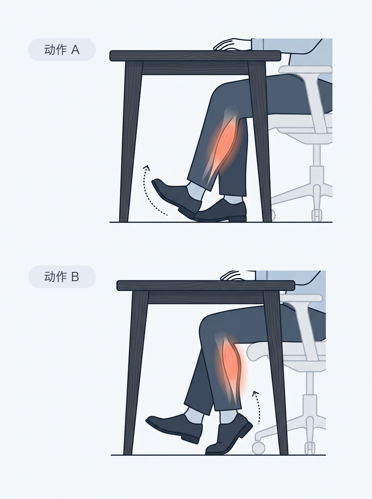

- **管什么：** 小腿腓肠肌与比目鱼肌。久坐导致下肢血液重力淤积、脚踝浮肿、小腿发胀。
- **怎么做：**
  1. 坐在办公椅上，双脚自然平放于办公桌下方地面。
  2. 双脚脚尖最大限度用力向上勾起，保持 2 秒，感受小腿后侧拉伸。
  3. 双脚脚尖下踩，脚后跟最大限度抬高踮起，保持 2 秒，收缩小腿肌肉。
  4. 以“勾-停-踮-停”的节奏平稳重复 12~15 次。
- **做对了 / 停止指征：**
  - *做对了：* 勾脚时小腿后方受拉，踮脚时小腿肌肉紧绷发力，反复后小腿有温热感。
  - *停止指征：* 若小腿肌肉出现抽筋先兆（肌纤维不受控收缩痉挛），立即平放脚掌，轻柔按摩小腿腹。
- **出处与说明：** 出自静静老师【07，00:08—00:20】无字幕视频。动作全程在桌面下隐蔽进行，不需站起，适合在不便离座时活动下肢。

---

## 第二部分：办公室 · 站立（可站起来，6 个）

### 7. 举手翻掌：站立位上肢高举，伸展前胸与背阔肌

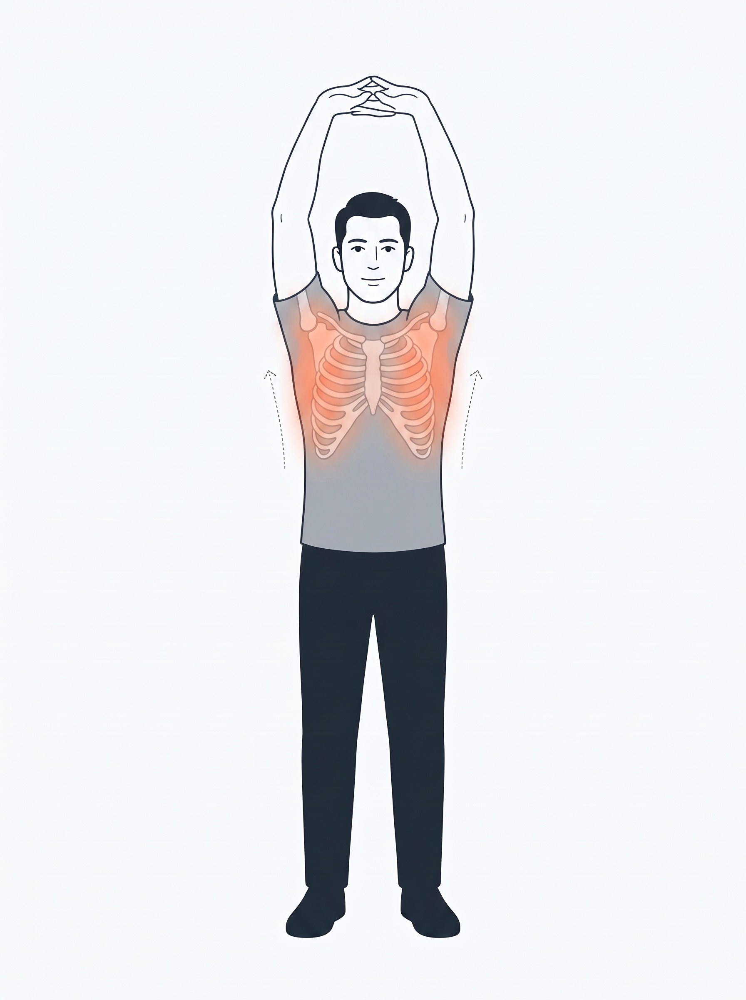

- **管什么：** 胸大肌、背阔肌、肩胛胸壁关节。久坐含胸驼背后的胸部与双肩紧缩。
- **怎么做：**
  1. 在工位旁站立，双脚与肩同宽站稳。
  2. 双手十指交叉推举过头顶。
  3. 掌心翻转朝向天花板，手臂伸直向上推引，并轻微向后展开。
  4. 腹部微收保持躯干平直，静止保持 30 秒，呼吸平稳。
- **做对了 / 停止指征：**
  - *做对了：* 腋下、两侧胸廓和上背部展开上提。
  - *停止指征：* 不要为了让手臂后伸而过度向前挺肚子折腰；肩关节若有撞击刺痛感，应降低手臂后展幅度。
- **出处与说明：** 出自工位底稿第 1 动作及强哥陪你练【02，00:00—00:06】。注意以肩胸延展为主，避免腰椎代偿后突。

---

### 8. 胳膊向后旋：双臂平举外旋，激活中下斜方肌与菱形肌

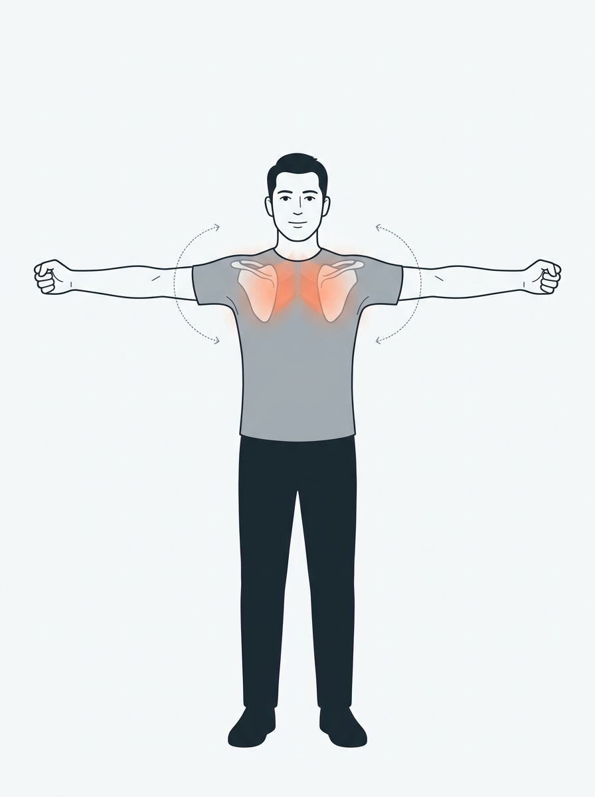

- **管什么：** 菱形肌、肩胛骨内收肌群。针对圆肩体态、肩胛骨习惯性前移。
- **怎么做：**
  1. 自然站立，双脚与肩同宽，挺胸收腹。
  2. 双臂向身体两侧水平展开，与肩膀平齐。
  3. 双手握空拳，整条手臂向后用力旋转，带动双肩向后充分打开。
  4. 感受两侧肩胛骨向中线夹紧并下沉，保持 30 秒。
- **做对了 / 停止指征：**
  - *做对了：* 两侧肩胛骨之间有肌肉主动发力酸胀感，前胸被动张开。
  - *停止指征：* 严禁耸肩，颈部不可前伸代偿；若肩关节前方有撕裂样锐痛，减小旋转幅度。
- **出处与说明：** 出自工位底稿第 2 动作及强哥陪你练【02，00:06—00:13】。该动作为主动肌群收缩，与纯被动拉伸不同，重点在肩胛内收。

---

### 9. 靠墙开胸：以墙面为支点，静态被动拉伸胸小肌与前胸廓

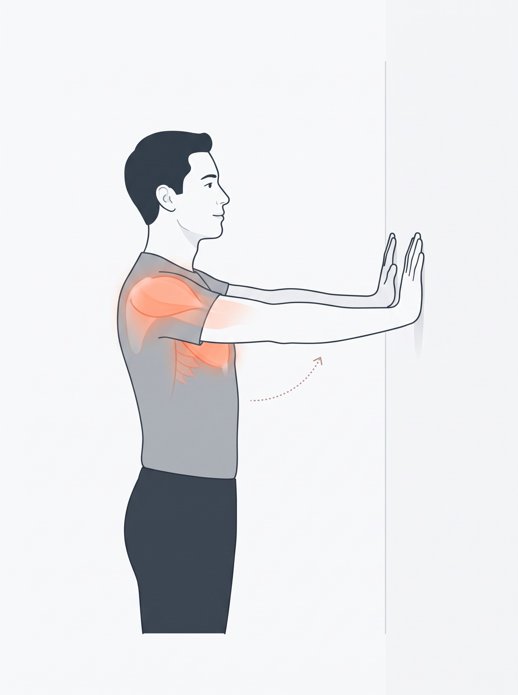

- **管什么：** 胸小肌、胸大肌锁骨部、前肩关节囊。长期键盘打字造成的双肩向前内扣。
- **怎么做：**
  1. 面向墙面站立，距离墙壁约一臂宽度，双脚站稳。
  2. 双肘弯曲撑在墙面，双手重叠放于颈后（或双肘小臂平贴墙面）。
  3. 上身缓慢向前移动，将胸口慢慢靠向墙面，胸椎向前挺出。
  4. 深长呼吸，静态保持 20~30 秒。
- **做对了 / 停止指征：**
  - *做对了：* 胸前侧及腋下有明显的牵拉舒展感。
  - *停止指征：* 若出现头晕、站立不稳或腰部代偿反弓刺痛，立即推离墙面回正。
- **出处与说明：** 出自工位底稿第 8 动作及应文杰MK【05，00:00—00:14】。原视频包含踮脚，普通人在平地全脚掌站稳同样能达到胸廓牵拉效果，且稳定性更高。

---

### 10. 扶腰后伸：双手支撑骨盆后部，引导腰椎平稳后伸

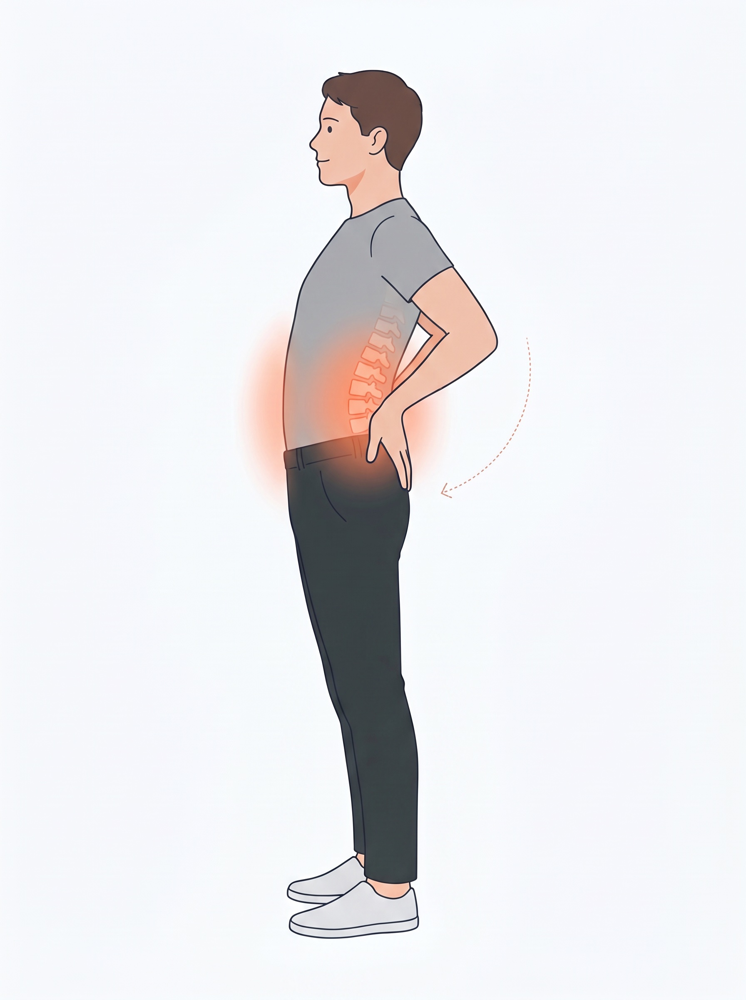

- **管什么：** 腰椎长期前屈疲劳、椎间盘向前受压。久坐弯腰弓背后的后侧纤维环减压。
- **怎么做：**
  1. 双脚与肩同宽站立，膝盖微松，重心平稳。
  2. 双手叉腰，大拇指在前，四指与手掌稳固托住后腰下侧（骨盆后上部）。
  3. 以双手为支撑点，上身缓慢向后仰伸，感受腰椎延展。
  4. 每次后仰维持 5 秒，随后平缓回正中立位，重复 8 次。
- **做对了 / 停止指征：**
  - *做对了：* 腰部在手掌稳固承托下缓慢后展，前腹有轻微拉长感。
  - *停止指征：* **严禁无保护快速甩腰**；若后仰过程中腰部出现尖锐针刺痛，或臀腿部出现放射性麻木痛，必须立即停止。
- **出处与说明：** 出自工位底稿第 9 动作及中国中医科学院西苑医院【09，00:10—00:45】。康复医生特别强调“双手必须提供可靠支撑”，避免腰椎无支点后折。

---

### 11. 站姿小燕飞：后伸双臂与轻度后仰，站位激活后侧链

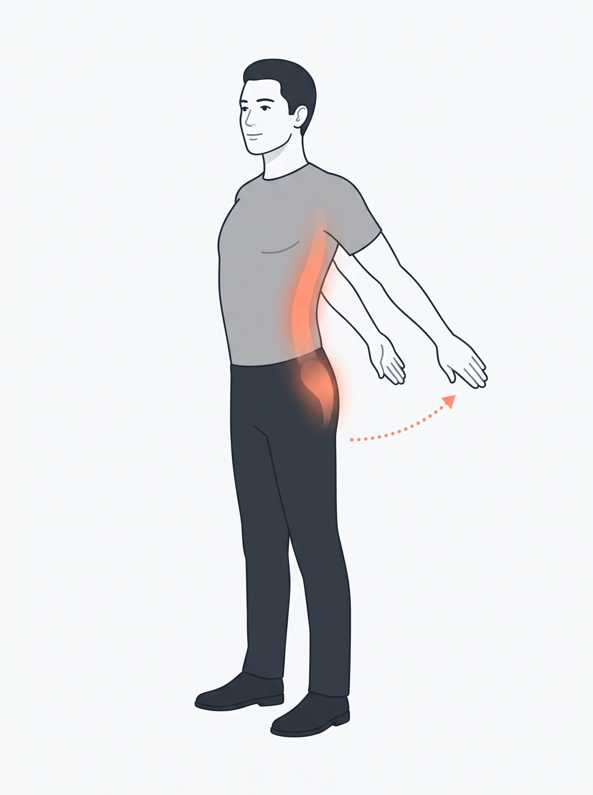

- **管什么：** 背部竖脊肌、臀大肌上部、菱形肌。针对久坐后躯干后侧肌群无力松弛。
- **怎么做：**
  1. 双脚与肩同宽站立，双脚踩实地面。
  2. 双肩向后充分展开，双臂向后下方伸直，掌心朝后或相对。
  3. 骨盆微向前送，胸腔上提打开，身体略向后延伸，保持 3~5 秒。
  4. 平缓回正放松，重复 8 次。
- **做对了 / 停止指征：**
  - *做对了：* 整个背部及臀部后侧肌群有轻度收紧感，呼吸保持自然。
  - *停止指征：* 切忌过度后仰与憋气；腰椎滑脱、椎管狭窄患者应慎做，出现腰痛立即停止。
- **出处与说明：** 出自工位底稿第 10 动作及中国中医科学院西苑医院【09，00:45—01:25】。西苑医院康复指导指出，卧位俯卧小燕飞对腰椎间盘压力较大，站立位小燕飞负荷更小，更适合工位人群日常活动。

---

### 12. 交叉腿叉腰侧屈：固定骨盆侧向倾斜，伸展腰方肌与侧腹

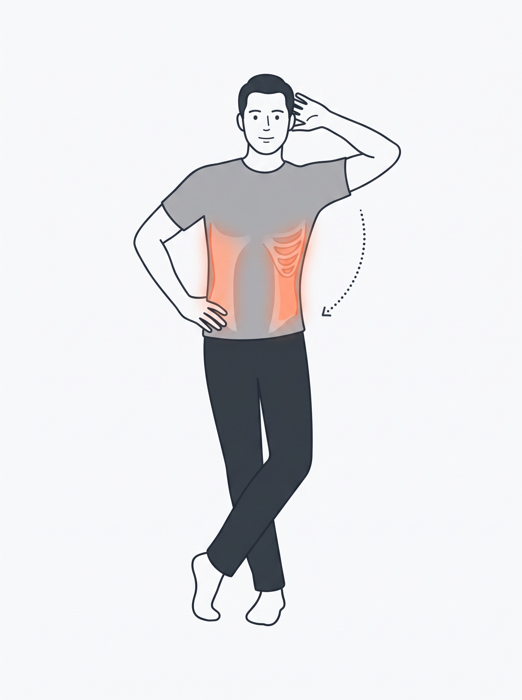

- **管什么：** 腰方肌、背阔肌下缘、腹外斜肌。习惯性单侧翘二郎腿或单侧侧倾导致的腰肌劳损。
- **怎么做：**
  1. 站立，一手叉腰。
  2. 对侧腿交叉跨放到身体斜后方，脚尖点地站稳。
  3. 另一侧手屈肘轻放于耳侧。
  4. 呼气时，上身在冠状面（纯侧面）向叉腰侧平缓侧弯，感受对侧腰胁部拉伸，保持 25 秒。
  5. 缓慢回正，换另一侧重复。
- **做对了 / 停止指征：**
  - *做对了：* 交叉腿同侧的腰侧与肋下有明显的深层拉长感，躯干没有前倾或扭转。
  - *停止指征：* 侧屈时若下腰部突发锐痛或下肢麻木，立即停止回正。
- **出处与说明：** 出自中国中医科学院西苑医院【09，01:00—01:35】。西苑医院作为久坐腰酸对症动作推荐，强调侧屈动作必须缓慢匀速。

---

## 第三部分：居家办公 · 大动作（3 个）

### 13. 标准深蹲：闭链下肢复合动作，调动下肢大肌群与全身血液循环

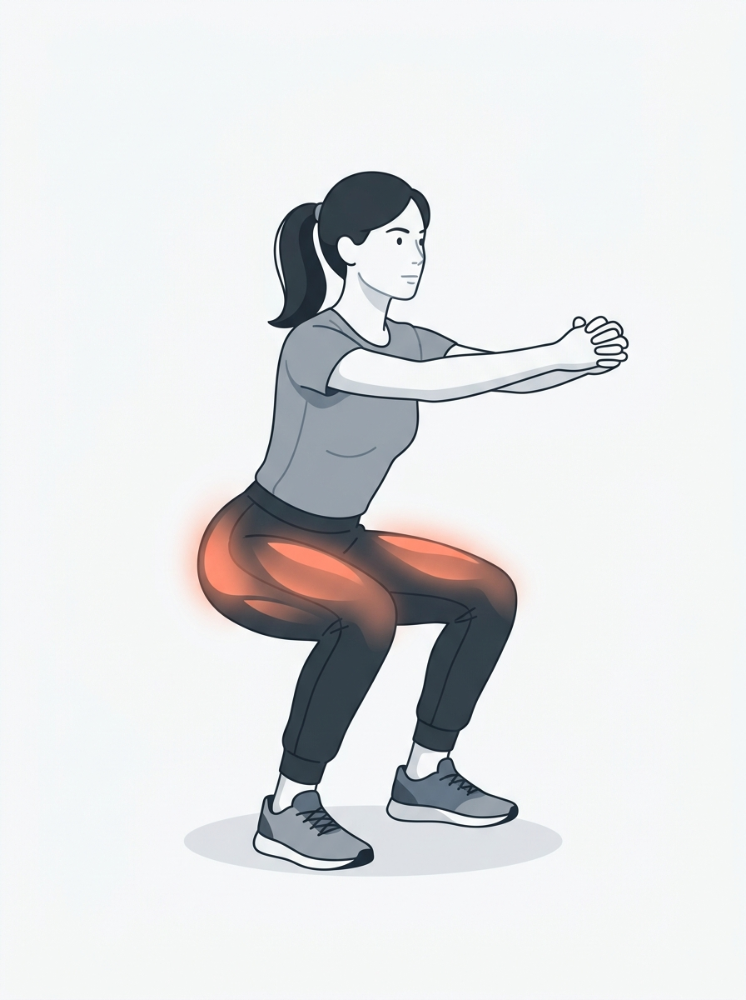

- **管什么：** 股四头肌、臀大肌、腘绳肌及核心稳定肌群。打破全天下肢静态代谢迟滞，促进血液循环。
- **怎么做：**
  1. 双脚站距与肩同宽或略宽于肩，脚尖自然向外展开约 15~30 度。
  2. 双手在胸前环抱或向前平举维持平衡，保持躯干直立，核心微收。
  3. 屈髋屈膝平稳下蹲，膝盖跟踪脚尖方向，下蹲至大腿与地面接近平行或膝关节夹角约 90°~120°。
  4. 双脚脚跟踩实地面，蹬地平稳站起恢复直立，重复 10~15 次。
  5. （插件内置 MoveNet 本地 AI 骨骼检测，可自动识别屈膝深度并计数）。
- **做对了 / 停止指征：**
  - *做对了：* 大腿前侧与臀部发力酸胀，重心始终落在全脚掌，全过程无憋气。
  - *停止指征：* **严禁膝盖内扣（X型腿）、脚后跟悬空或弯腰弓背**；若膝关节出现卡压弹响伴随刺痛，立即停止。
- **出处与说明：** 经典抗阻基础动作。在居家插件中通过本地 TensorFlow.js 与 MoveNet 神经网络模型实时捕捉髋、膝、踝关节点，完成下潜达标与站起复位的闭环检测。

---

### 14. 蹲下碰地送屁股：利用手掌支撑锚定，安全伸展腘绳肌与下背

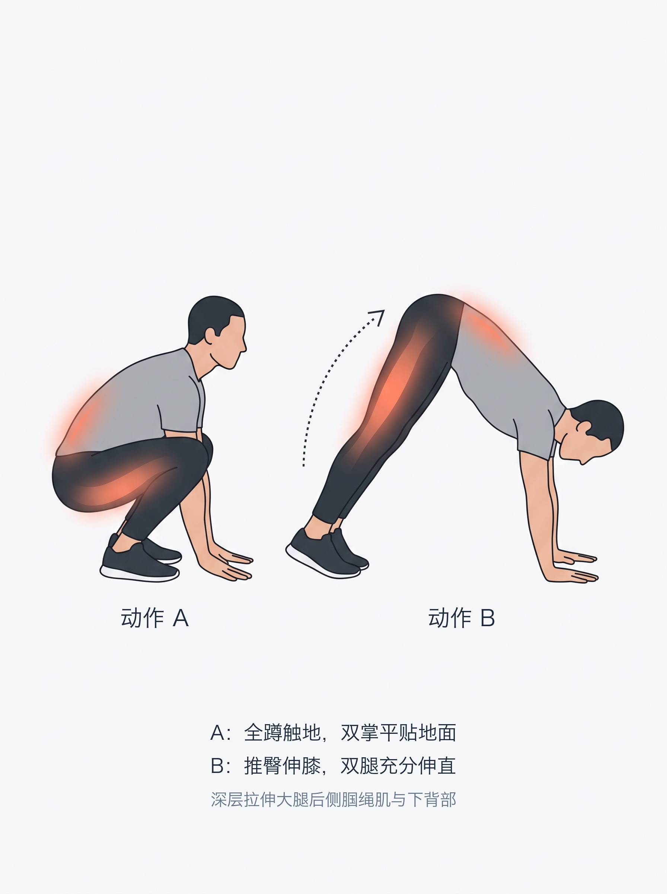

- **管什么：** 大腿后侧腘绳肌、小腿后侧肌群、下背胸腰筋膜。久坐导致的骨盆后倾与后侧链短缩。
- **怎么做：**
  1. 双脚与肩同宽站立。
  2. 屈膝下蹲，双手全手掌平稳贴紧压实地面（后背保持自然平直，不松垮弯弓）。
  3. 手掌始终紧贴地面不离开，用力将臀部向上推起、尽量伸直双腿。
  4. 在双腿伸直的高位维持 2 次平稳呼吸（约 4 秒），感受大腿后侧拉伸。
  5. 屈膝下蹲还原，重复 8 次。
- **做对了 / 停止指征：**
  - *做对了：* 大腿后侧产生清晰的拉伸张力；由于双手撑地分担了上半身重量，下腰部无下坠剪切感。
  - *停止指征：* 下蹲时后腰不要完全软塌；送屁股伸膝时严禁猛烈弹震，若腘窝（膝盖正后方）出现剧烈刺痛，应降低抬臀幅度。
- **出处与说明：** 出自叔贵跟练视频【08，00:00—00:30】。相比站立位悬空体前屈，手掌撑地能为脊柱提供封闭支撑，显著降低椎间盘剪切压力，提升腘绳肌牵拉的安全性。

---

### 15. 垫上养腰：婴儿式卸力与眼镜蛇式伸展（组合动作）

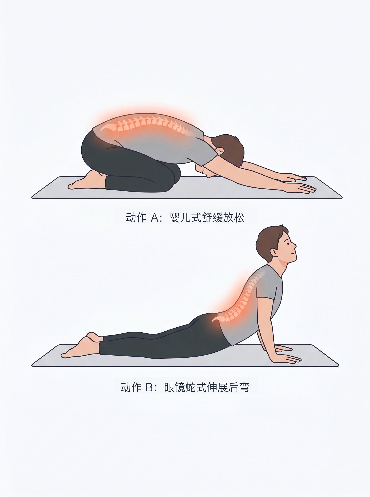

- **管什么：** 竖脊肌板结、脊柱纵向压力积累、前屈后伸不平衡。久坐一整天后的脊柱零负荷舒展。
- **怎么做：**
  1. **前半程 · 婴儿式（30 秒）：**
     - 俯身跪坐在瑜伽垫或平整软垫上，臀部坐向脚跟。
     - 双臂向前平铺延伸，额头轻贴地面。
     - 脊柱与肩颈完全卸力放松，深长腹式呼吸保持 30 秒。
  2. **后半程 · 眼镜蛇式 / 俯卧伸展（30 秒）：**
     - 身体向前滑行转为俯卧位，双手撑在胸部两侧（或以手肘小臂着地）。
     - 双手推地，缓慢撑起上半身，胸口向前上方挺出。
     - 腹部轻微拉伸，腰椎温和后伸，保持 30 秒。
- **做对了 / 停止指征：**
  - *做对了：* 婴儿式时下背肌群被动伸展卸力；眼镜蛇式以前胸伸展为主，后腰无挤压刺痛。
  - *停止指征：* 眼镜蛇式撑起时，如果后腰出现尖锐挤压刺痛，应立即改用手肘小臂贴地（狮身人面式），若仍有痛感则立刻停止。
- **出处与说明：** 出自气血平衡的京格格【12，图 02 与图 03】。动作组合借鉴了瑜伽放松姿势与麦肯基疗法（McKenzie Method）的俯卧伸展原理，以两段式达到屈曲卸力与适度伸展平衡。

---

## 单独列出的动作分歧、代偿与安全排雷

### 做法和指导上的分歧

| 争议点 | 素材 A 做法 | 素材 B 做法 | 本次处理原则与原因 |
|---|---|---|---|
| **拉伸脖子时手掌是否用力** | **部分图文封面：** 双手按住头部向下用力拉扯。 | **04 颈脖然：** 反复强调手掌“只是搭在头上，千万不要用力按”。 | **采纳轻搭原则。** 颈椎周围神经丛与椎动脉脆弱，被动暴力施压极易导致关节小面错位或神经根压迫。手仅作自重引导，严禁外力下扳。 |
| **小燕飞应趴着还是站着** | **传统做法：** 俯卧在床上两头翘起（俗称俯卧小燕飞）。 | **09 西苑医院：** 推荐“站姿小燕飞”，站立位微后伸双臂与骨盆。 | **采纳站姿做法。** 卧位小燕飞对已有腰肌劳损或腰突人群压力过大，站姿小燕飞更温和可控，适合在工位短时活动。 |
| **下腰后伸的受力支点** | **常见自行后仰：** 双腿直立，直接向后甩腰、挺肚子。 | **09 西苑医院：** 强调双手叉腰，大拇指在前，手掌稳固托住骨盆后上部作为支点。 | **采纳双手支撑后伸。** 缺乏双手支撑的甩腰会直接把重力剪切力集中于第 4、5 腰椎与骶骨，托住骨盆能有效分担腰椎应力。 |
| **久坐拉伸腿后侧的方式** | **传统体前屈：** 站立双腿伸直，悬空弯腰用手指碰脚尖。 | **08 叔贵：** 强调先蹲下让双手手掌完全贴地，再向上蹬起伸直双腿送屁股。 | **采纳蹲下送屁股。** 站立悬空体前屈使重力杠杆全由腰椎间盘承担；手掌贴地将开链变成闭链支撑，保护腰椎的前提下孤立拉伸腘绳肌。 |

---

### 为什么排除常见动作（排雷清单与不收录原因）

在筛选适合工位与居家的动作时，本库明确**淘汰并排除了以下 4 类流传较广的高风险动作**：

1. **大幅度快速绕圈甩头（颈部大回环）：**
   
   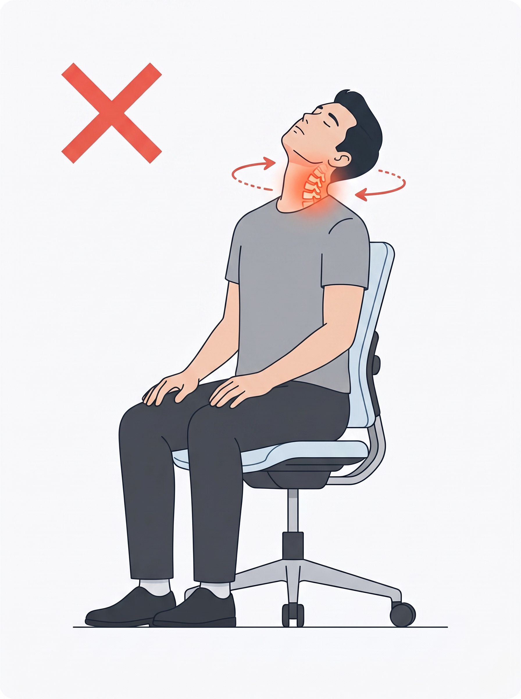
   
   - *淘汰原因：* 颈椎在极度后伸伴随旋转时，椎动脉和颈神经根会受到椎骨骨性压迫，容易引起供血不足性眩晕、恶心，甚至加重颈椎关节小面错位与骨刺增生。
   - *正确替代：* 动作 01（背后交扣侧头）或动作 02（耳朵找肩膀），单一水平面侧屈。

2. **双手扣住后脑勺暴力下扳：**
   
   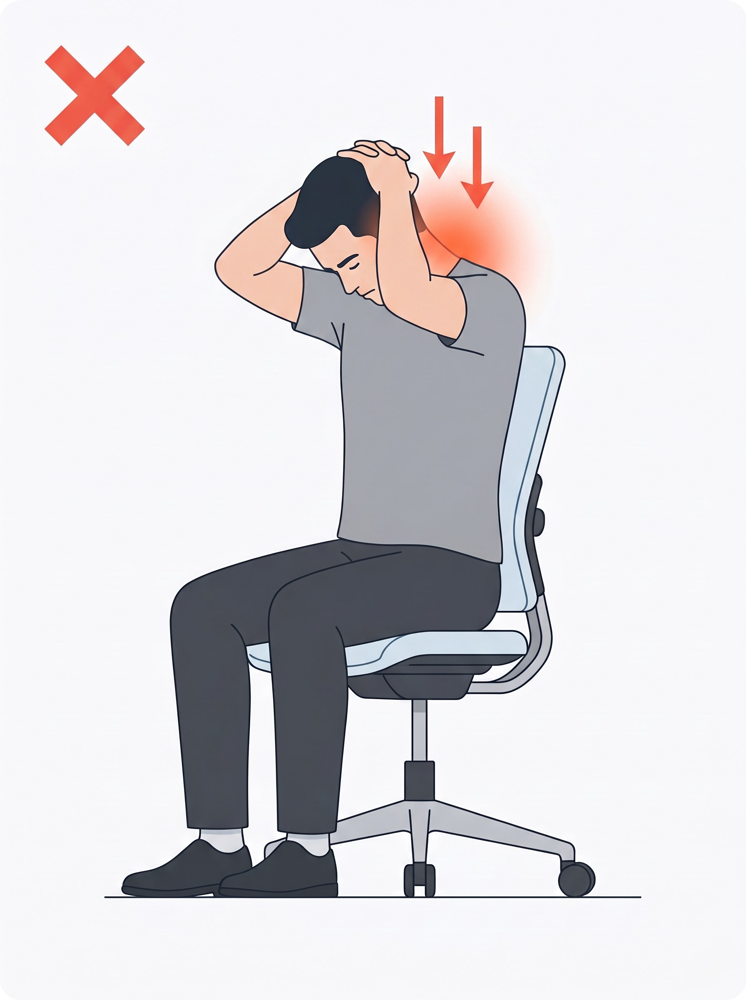
   
   - *淘汰原因：* 强力外力迫使颈椎过度前屈，瞬间加剧颈椎间盘后方的张力，对已有颈椎生理曲度变直或轻度椎间盘膨出者存在诱发神经压迫风险。
   - *正确替代：* 动作 05（托后脑低头），微收下巴，以头部自重主导，严禁外力下按。

3. **无支撑悬空长时间极度仰头：**
   
   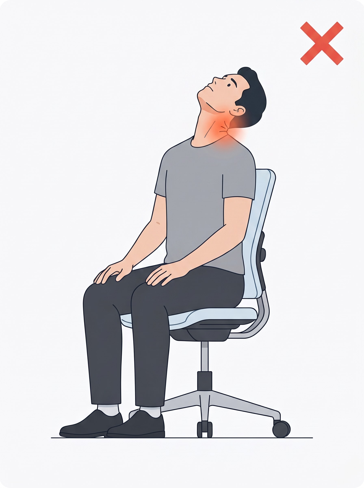
   
   - *淘汰原因：* 长时间悬空向后仰头会导致后颈肌群被动短缩挤压，压迫枕大神经，易造成后枕部发麻及体位性低血压。
   - *正确替代：* 动作 04（手按锁骨看斜上方），固定前侧筋膜后再温和看斜上方；或动作 10（双手稳固托住骨盆后伸）。

4. **站立直腿猛烈震颤压腿/压腰：**
   
   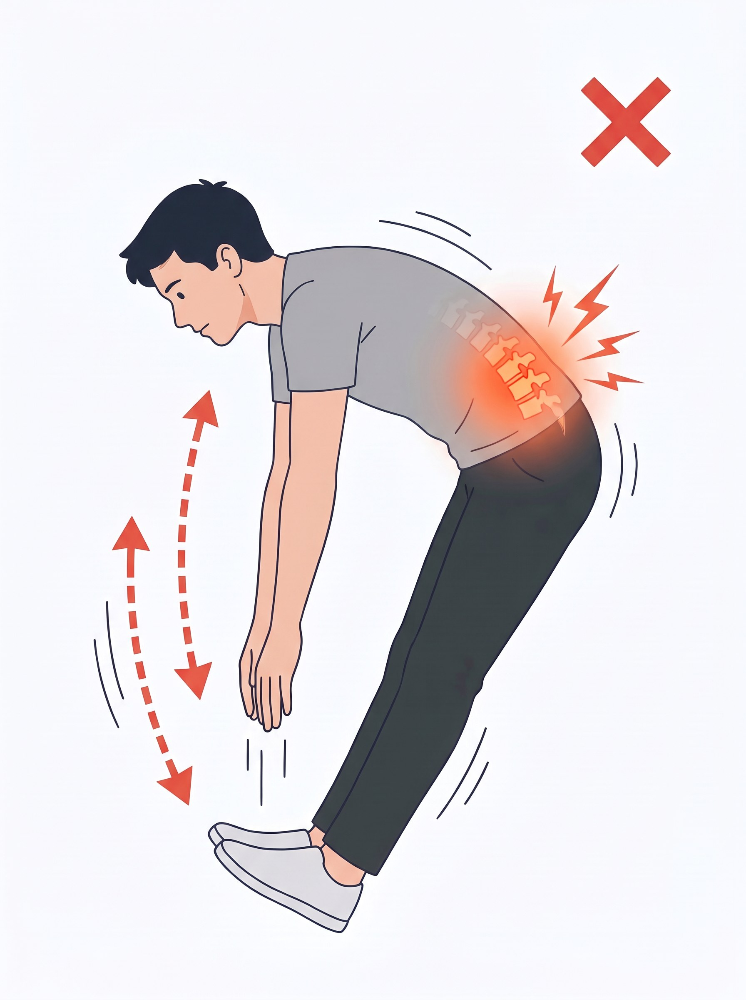
   
   - *淘汰原因：* 弹震式拉伸会触发牵张反射导致肌肉保护性痉挛，且悬空弯腰弹震时椎间盘受到的瞬时剪切力过大，极易引发急性腰扭伤。
   - *正确替代：* 动作 14（蹲下碰地送屁股），双手全手掌撑地卸载腰椎，再蹬直双腿闭链拉伸。

---

## 素材核读记录与逐篇索引

本清单动作梳理自以下 12 篇素材及底稿：

| 篇号 | 标题 | 作者 | 形式 | 本清单提取或参考内容 |
|---|---|---|---|---|
| **01** | 🔥100w人催更！弯腰驼背\|脖子前倾（跟练版） | 大程子要努力 | 视频（7:59） | 手按锁骨看斜上方（02:40—03:10） |
| **02** | 当经常久坐低头肩颈僵硬不适的你开始这些练习了 | 强哥陪你练 | 视频（0:20） | 举手翻掌（00:00—00:06）、胳膊向后旋（00:06—00:13） |
| **03** | 跟着央妈一起改善脖子前倾 | 冰冰i健身 | 视频（0:36） | 托后脑低头（00:15—00:28，微收下颌低头要点） |
| **04** | 肩颈脖子不舒服，跟着一起这样练 | 颈脖然 | 视频（0:39） | 耳朵找肩膀（00:03—00:12）、低头看腋窝（00:12—00:22） |
| **05** | 你的脖子也这样吗？一招纠正你的乌龟颈 | 应文杰MK | 视频（0:14） | 靠墙开胸（00:00—00:14） |
| **06** | 巨有效🔥7min跟练版‼️练完脖子肩颈舒服了 | 爱运动的莎儿 | 视频（7:09） | 动作重复度高且后段无字幕，仅作动作形态交叉对照 |
| **07** | 久坐党救星！坐着就能练！ | 静静老师 | 视频（0:28） | 桌下勾脚踮脚（00:08—00:20，无上身小腿泵血） |
| **08** | 1mins久坐拉伸，腰腿巨舒服（宇宙级简单 | 叔贵 | 视频（0:41） | 蹲下碰地送屁股（00:00—00:30，手撑地护腰拉腘绳肌） |
| **09** | 久坐腰酸别硬扛，两个动作轻松缓解 | 中国中医科学院西苑医院 | 视频（1:40） | 扶腰后伸（00:10—00:45）、站姿小燕飞（00:45—01:25）、交叉腿侧屈（01:00—01:35） |
| **10** | 最伟大的拉伸（颈部版），您确定不来试试吗？ | 物理治疗师-Marco | 图文（5 张） | 背后交扣侧头（图 02，双手移至腰侧夹肘固定肩胛） |
| **11** | 工位上不用换衣服，不用器械打开紧张的肩膀 | 恩妮｜工位体态教练 | 视频（3:54） | 办公椅开肩对照验证，部分动作需要宽大椅背，未作主选 |
| **12** | 久坐党就多练这8个动作❗️把腰养回来 | 气血平衡的京格格 | 图文（7 张） | 垫上养腰：婴儿式（图 02）与眼镜蛇式（图 03）组合 |
| **AI** | MoveNet 骨骼姿态实时检测算法 | 本地 TensorFlow.js | 插件引擎 | 标准深蹲（闭环检测髋膝踝关节角度变化与下蹲计数） |
